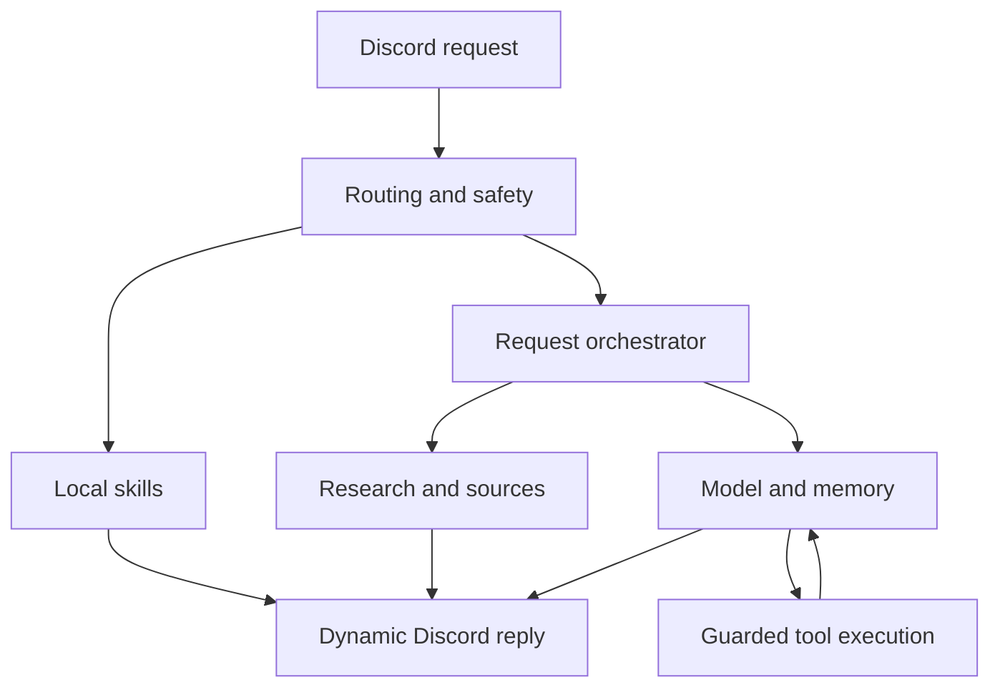

# Lexus request orchestration

16 November 2026. Applies to `krishna3251/lexus_dc` from main commit `d92827d`.

The audit traced natural messages, mentions, prefix commands and slash commands through
`cogs/ai_engine.py`, the shared AI engine, memory, research, provider adapters,
permission checks and the Discord reply formatter. `chat_lex` delegates conversation
to that engine. Coding and other feature adapters retain their existing interfaces.

| Audit finding | Implemented behavior |
| --- | --- |
| Every Groq request hardcoded low reasoning effort | The orchestrator selects low, medium or high effort from task complexity and passes it to the configured GPT-OSS adapter. |
| Tool-enabled requests received the full registry | Only tools permitted by the execution plan and the requester's current permissions enter the model's schema list. Authorization is checked again before execution and before cached results are reused. |
| Tool results were sliced into potentially invalid JSON | Bounded observations preserve the authoritative success flag and explicitly mark an excerpt as truncated. |
| Growing observations could end a task with a context-limit error | Old conversation turns and large tool observations are compacted within the configured budget. The current request and complete tool-call/result protocol are retained. Schema size also counts toward that budget. |
| Repeated reads produced duplicate-suppression errors | Successful reads are reused within the same request. A failed read gets one retry opportunity. A repeat-only batch leads to a final response step. |
| Freshness words could send server questions to web search | Live server questions such as “today server report” use Discord routing. An explicit search or research request retains web routing. |

`services/ai_engine/orchestrator.py` owns the execution envelope, reasoning budget,
permitted schemas and working-context compaction. The engine coordinates the
existing model/tool loop and request-local observation reuse. Existing local
calculations and exact bot lookups can finish before model inference.

Casual conversation selects low effort and remains eligible for local or economy
inference. Technical requests, research and live Discord inspections normally
select medium effort. Architecture, root-cause analysis, optimization and explicit
complex-reasoning cues select high effort and prefer the primary model. These are
local routing heuristics. The configured model performs reasoning and checks its
answer against the supplied observations.

Medium effort reserves 512 completion tokens for reasoning, and high effort
reserves 1,536, in addition to the existing visible-answer allowance. The shared
completion ceiling remains 4,096 tokens. Research retains its configured total
output allowance. These reserves can increase token use and latency on harder
requests. No extra planning or judging model request is made.

The Groq adapter sends native `reasoning_effort` and `include_reasoning=false`
for `openai/gpt-oss-20b` and `openai/gpt-oss-120b`. Other configured model names
receive their existing compatible parameters. Local inference retains its text
interface. Groq documents the supported controls in its
[reasoning reference](https://console.groq.com/docs/reasoning).

For multi-iteration requests, the last iteration requests a final answer with no
new tool calls. Each tool call remains subject to the existing validator,
permissions, execution limits and confirmation flow. Reused observations are
scoped to one admitted request. The tool retry path applies to reads, while
confirmed mutations keep their existing one-use behavior. An output that reaches
its completion limit is visibly marked as incomplete.

`lx aistatus` and engine health expose aggregate reasoning-mode counts, reused
inspections and context compactions. These counters contain no prompts, private
reasoning or user identifiers. They describe control flow and resource use.

Validation uses mocked providers, Discord contexts and SDK responses. Tests cover
reasoning selection through the normal engine entry point, provider compatibility,
server-versus-web routing, private output handling, successful read reuse, a failed
read retry, final-step limits and valid JSON after context compaction. Existing
privacy, tool permissions, mutation-confirmation and Discord delivery tests remain
part of the full suite. Live provider quality, latency, billing and deployed
Discord behavior require runtime observation. Model instructions and structural
checks cannot prove that every generated claim is correct.
